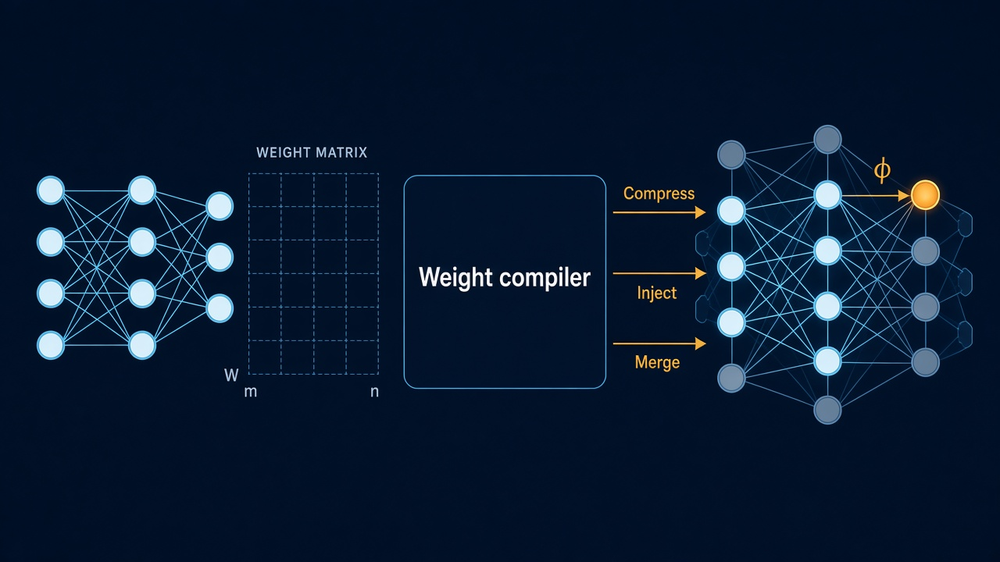
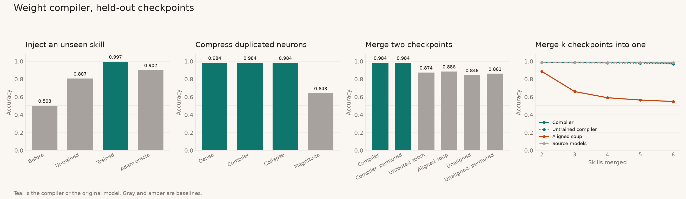

# zeroth-grad

A weight-space compiler. It reads a small MLP checkpoint (`.safetensors` or `.pt`) and writes an edited checkpoint in one forward pass. Compress, inject, and merge never run an optimizer on the network being edited.

The compiler itself is trained. Each step samples a checkpoint from a zoo of models trained on synthetic halfspaces, applies an edit, and backpropagates a functional loss into the compiler only. At apply time the checkpoint tensors are constants.



## Edit families

Hidden units are a set. Permuting a layer permutes that layer's tokens and leaves the other layer's tokens in place, because messages between layers are products with the weight matrix (`W @ features`), not a flattened parameter vector.

**Inject.** Install an unseen halfspace on a chosen output head. Spare neurons (outgoing norm zero) are overwritten with a rank-1 circuit

```
ΔW1 = a φᵀ,   ΔW2 = c sᵀ,   ΔW3[head] = r
```

with scales `a`, `s`, `c`, `r` predicted by the compiler. Old heads are left alone, so the skill already in the checkpoint stays put. `φ` is the concept direction, or `normalize(mean(x | y=1) - mean(x | y=0))` estimated from a labeled batch.

**Compress.** Exact duplicate neurons (incoming cosine at least 0.999) are one cluster. The compiler keeps one neuron per cluster, up to the pre-duplication width, and adds the dropped copies' outgoing weights onto the survivor. A learned residual breaks ties; on exact copies the collapse is geometric. Magnitude pruning keeps the largest fragments and drops the rest, which is the baseline this edit beats.

**Merge.** Hidden units of checkpoint B are matched to A with the Hungarian algorithm. The cost is magnitude-weighted cosine distance on incoming weights (row plus bias), plus a penalty for pairing two live neurons whose incoming directions disagree. Per-neuron gates mix the endpoints, and a connection is kept only when both endpoints come from the same parent. A random hidden permutation of B is undone by the match, so the merged function does not depend on that permutation.

Output heads have a parent too. Each head gets an ownership gate

```
λ3[k] = sigmoid(τ · log(|w3_A[k]| / |w3_B[k]|) + residual[k])
```

and the same-parent rule covers the readout: head k reads a hidden unit only when both come from the same parent, and `b3[k]` follows the owner. `τ` is learned (initialized at 4, so the prior is the readout-norm ratio raised to the fourth power), and the residual is read from hidden-2 tokens pooled along each head's readout direction. Without this gate, a skill head also reads the other parent's untrained readout weights, and that crosstalk was the whole merge gap. Ownership assumes a parent's untrained readout rows are smaller than the other parent's trained row for the same head, which holds when untrained rows stay near their initialization scale.

`merge_many` folds any number of checkpoints left to right, `merge(merge(c0, c1), c2)`.

## Models

Inputs are `x ~ N(0, I_16)`. Eight fixed orthonormal directions define the skills `y = 1[v_k · x > 0]`. The MLP is `16 → 32 → 32 → 8`: one logit per skill, so two skills can be true of one checkpoint at the same time. A single shared logit cannot score well on two different halfspaces of the same `x`.

The zoo is trained from one shared initialization. Skills 0–5 are the training skills. Skills 6–7 are held out and are the inject targets. The last two seeds of each training skill are held out as well. Four hidden units in each layer are pinned at zero during student training, and any further neuron whose removal does not change skill accuracy is zeroed afterward. Those spares are where an inject lands.

## Results

Held-out checkpoints, CPU, after `populate --steps 300` and `train --steps 400`. Accuracy is mean sign agreement on 2,500–3,000 fresh samples. The full dump is written to `runs/metrics.json`. `python scripts/plot_results.py` redraws the figure below from that file.



**Inject** (24 edits: 12 held-out models × skills 6 and 7):

| | new skill | old skill |
| --- | ---: | ---: |
| checkpoint before the edit | 0.503 | 0.983 |
| untrained compiler (geometric prior only) | 0.807 | 0.983 |
| trained compiler | 0.997 | 0.983 |
| 200-step Adam on the target (oracle) | 0.902 | — |

**Compress** (12 held-out models, every live neuron split into four equal copies, shuffled):

| | skill accuracy |
| --- | ---: |
| original dense checkpoint | 0.984 |
| compiler | 0.984 |
| closed-form cluster collapse | 0.984 |
| magnitude pruning at the same width | 0.643 |

**Merge** (30 held-out pairs, mean accuracy on the two source skills):

| | accuracy |
| --- | ---: |
| each source checkpoint on its own skill (ceiling) | 0.985 |
| compiler | 0.984 |
| untrained compiler (alignment, norm gates, head ownership) | 0.984 |
| norm-gate stitch without head ownership | 0.874 |
| uniform average, no alignment | 0.846 |
| uniform average after alignment | 0.886 |
| compiler, partner hidden units permuted | 0.984 |
| uniform average, partner hidden units permuted | 0.861 |

The merge is lossless up to the ceiling, and permutation does not move it. Without head ownership the same stitch scores 0.874: alignment already places the two parents' live units in different slots (one collision in 30 pairs), and the remaining loss is readout crosstalk.

**Merge k checkpoints** (every k-subset of distinct held-out skills sharing a seed, folded into one 32-wide network, mean accuracy on the k skills):

| k | subsets | compiler | untrained compiler | aligned uniform soup | ceiling |
| ---: | ---: | ---: | ---: | ---: | ---: |
| 2 | 30 | 0.984 | 0.984 | 0.886 | 0.985 |
| 3 | 40 | 0.984 | 0.983 | 0.660 | 0.985 |
| 4 | 30 | 0.984 | 0.982 | 0.591 | 0.985 |
| 5 | 12 | 0.984 | 0.979 | 0.565 | 0.985 |
| 6 | 2 | 0.980 | 0.971 | 0.549 | 0.985 |

Six single-skill checkpoints fit in one network at the original width. The trained ownership temperature (4.0 to 5.2 over training) is what separates the compiler from its initialization as k grows. Compiler training seeds 0, 1, and 2 give 0.984 on pairs and 0.979–0.980 at k = 6.

## Commands

```bash
python -m zeroth_grad populate --out checkpoints
python -m zeroth_grad train --checkpoints checkpoints --out runs/compiler.pt
python -m zeroth_grad eval --compiler runs/compiler.pt --checkpoints checkpoints

python -m zeroth_grad widen --ckpt checkpoints/heldout_single_s0_seed5.safetensors \
    --out /tmp/wide.safetensors --copies 4 --shuffle
python -m zeroth_grad compile compress --ckpt /tmp/wide.safetensors --out /tmp/slim.safetensors

python -m zeroth_grad compile inject --ckpt checkpoints/heldout_single_s0_seed5.safetensors \
    --concepts checkpoints/concepts.pt --concept-index 6 --head 6 --out /tmp/injected.safetensors

python -m zeroth_grad compile merge \
    --ckpt-a checkpoints/heldout_single_s0_seed5.safetensors \
    --ckpt-b checkpoints/heldout_single_s1_seed5.safetensors \
    --out /tmp/merged.safetensors

python -m zeroth_grad compile merge --ckpts checkpoints/heldout_single_s{0,1,2,3}_seed5.safetensors \
    --out /tmp/merged4.safetensors

python scripts/plot_results.py
```

`compile merge` folds `--ckpts` (or `--ckpt-a` followed by one or more `--ckpt-b`) left to right, and the output's `skills` metadata is the union of its parents'. `compile inject` also accepts `--examples batch.pt` (`{"x", "y"}`) or `--phi direction.pt`. `compile` runs under `torch.no_grad()` and does not require gradients on the loaded tensors.

`checkpoints/` and `runs/` are local artifacts. Tests run with `pip install -e ".[dev]"` and `pytest`; the figure needs `matplotlib` (`pip install -e ".[plot]"`).

## Neighbors

Git Re-Basin aligns hidden units before averaging. Task arithmetic edits a checkpoint by adding a task vector. Deep weight-space networks and neural functional transformers process a network's weights with permutation-equivariant layers. Those methods are the neighborhood. This repository is the checkpoint-to-checkpoint map: one forward pass that compresses, injects, or merges, trained by the edited model's loss and not by a training loop on that model.

## Layout

`src/zeroth_grad/` holds the MLP and functional forward (`mlp.py`), synthetic skills (`data.py`), checkpoint I/O (`io.py`), Hungarian alignment (`align.py`), the edit algebra (`edit.py`), the equivariant compiler (`compiler.py`), the zoo (`zoo.py`), functional training (`train.py`), held-out eval including the k-way merge curve (`evaluate.py`), and the CLI (`cli.py`).
