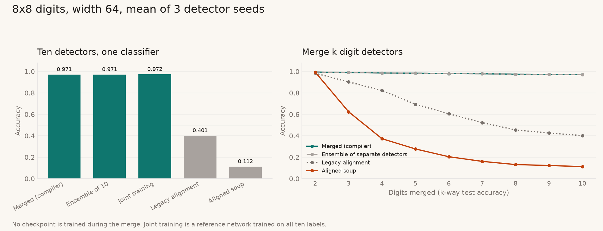
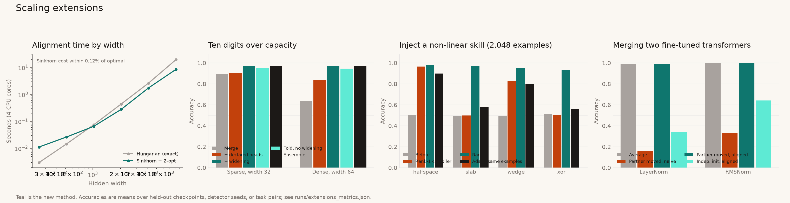

# Zeroth-Grad: Compiling Checkpoint Edits in Weight Space

**Aaron Grace** · October 2026 · Code, data, and figures: [github.com/AaronGrace978/zeroth-grad](https://github.com/AaronGrace978/zeroth-grad)

*Technical report, draft 2. The implementation and experiments were developed with AI coding assistants. Every number below is produced by the commands in Section 9 and lands in `runs/metrics.json`, `runs/digits_metrics.json`, or `runs/extensions_metrics.json`.*

---

## Abstract

Editing a trained network usually means training it again. This report describes a *weight-space compiler*: a map from one checkpoint to another that runs as a single forward pass and never applies an optimizer to the network being edited. The compiler reads the weights of a small multilayer perceptron as a set of hidden-unit tokens, processes them with a permutation-equivariant encoder, and predicts residual corrections to three geometric edits. **Inject** installs a new skill on a chosen output head. **Compress** removes duplicated hidden units. **Merge** combines checkpoints trained on different skills into one network of the same width.

Two components make merging work: a per-head readout-ownership gate, and a Hungarian alignment cost that measures interference between hidden units instead of geometric distance. On a synthetic zoo of halfspace detectors, merging is lossless up to the source models' accuracy (0.984 against a ceiling of 0.985), where uniform averaging after alignment reaches 0.887. Six single-skill checkpoints fold into one 32-wide network at 0.977. On scikit-learn's 8×8 handwritten digits, ten one-vs-rest detectors merge without training into one 64-wide network. Read as a 10-way classifier, it scores 0.971 on held-out images: exactly the accuracy of the ten detectors run separately, and about 0.001 below a same-size network trained on all ten labels. The governing constraint is capacity. A merge is lossless when the parents' live hidden units fit in the width, and a group-sparsity penalty during detector training cuts the units needed from about 123 to about 45.

Five extensions address the limits of that picture (Sections 4.7–4.11 and 5.7–5.10). Sinkhorn optimal transport replaces the cubic Hungarian solve, running 2.3 times faster at width 8,192 and landing within 0.12% of the optimal cost. Collision-driven widening, exact sharing of parallel units, and declared head ownership make every over-capacity digits merge equal its ensemble. That includes dense detectors, which go from 0.633 to 0.967. Activation folding compacts dense or over-capacity parents at fixed width, raising the width-32 ten-digit merge from 0.891 to 0.950. A closed-form rank-k inject installs non-linear skills (slab, wedge, XOR) that a rank-one write cannot express, reaching 0.935–0.980. Finally, the symmetries of a small transformer (residual permutation, scale and rotation, head permutation, and per-head orthogonal maps) are made explicit, and weight matching over them undoes a hidden symmetry exactly.

---

## 1. Introduction

A trained checkpoint is usually treated as the output of an optimizer: to change what it computes, you run the optimizer again. That is expensive, it needs data for the new behavior, and it can damage behavior you wanted to keep. This project asks a different question. Can a network learn to *edit other networks' weights directly*, in one pass, the way a compiler rewrites a program?

Three properties make the question tractable for small MLPs:

1. **Hidden units are a set.** Permuting the hidden units of a layer, together with the matching rows and columns of the adjacent weight matrices, leaves the function unchanged. An editor should be equivariant to these permutations, so that relabeling a checkpoint relabels the edit and changes nothing else.
2. **Many edits have a geometric core.** Duplicated units can be collapsed exactly, a linear feature can be written onto unused units, and two networks' units can be matched before mixing. A learned model only needs to predict a correction on top.
3. **The loss is functional.** The compiler is trained by evaluating the *edited* network on data and backpropagating into the compiler's parameters. The checkpoint tensors stay constants.

### Contributions

- A permutation-equivariant compiler for two-hidden-layer MLPs that performs inject, compress, and merge in one forward pass, trained with a functional loss on a zoo of checkpoints (Section 4).
- **Per-head readout ownership** for merging: the rule "keep a connection only when both endpoints come from the same parent", extended to the output layer through a gate with a learned temperature. On the synthetic zoo it closes the entire gap between the previous stitch (0.874) and the source ceiling (0.985) (Section 4.4).
- An **interference-based alignment cost** that sends live units to free slots before letting any two collide. On real images the previous, geometric cost collapsed ten detectors into about ten slots (0.401 accuracy); the interference cost reaches 0.971 (Section 4.4, Section 5.6).
- A sufficient condition under which a merge exactly reproduces each parent's heads, and experiments that trace accuracy against that capacity condition on synthetic and real data (Sections 4.5 and 5).
- **Scalable alignment**: an epsilon-scaled Sinkhorn solver with plan rounding and local repair, interchangeable with Hungarian matching (Sections 4.7 and 5.7).
- **Capacity management** for merges past the capacity condition: widening on collisions, exact slot sharing for positively parallel units, declared ownership, and activation folding for dense parents (Sections 4.8, 4.9 and 5.8).
- A **rank-k inject** that writes a k-dimensional ReLU circuit estimated from labeled examples (Sections 4.10 and 5.9).
- **Transformer symmetries and alignment** for attention heads and the residual stream (Sections 4.11 and 5.10).

---

## 2. Background and related work

**Permutation symmetry and alignment.** Entezari et al. (2022) conjectured that, once permutation symmetry is accounted for, independently trained networks lie in one linearly connected basin. Git Re-Basin (Ainsworth et al., 2023) aligns hidden units by weight or activation matching before averaging. Optimal-transport fusion (Singh & Jaggi, 2020) uses soft alignments. All three use the Hungarian method (Kuhn, 1955) or a relaxation of it. This project reuses Hungarian matching, but changes what the cost measures (Section 4.4), and solves wide layers by entropic optimal transport with Sinkhorn iterations (Cuturi, 2013) followed by rounding to a permutation (Section 4.7).

**Merging without training.** Model soups (Wortsman et al., 2022) average fine-tuned checkpoints of one task. Fisher-weighted averaging (Matena & Raffel, 2022), task arithmetic (Ilharco et al., 2023), and TIES-merging (Yadav et al., 2023) combine task-specific updates. ZipIt! (Stoica et al., 2024) merges models trained on *different* tasks without retraining, allowing features to be shared within one model; it is the closest neighbor to the merge studied here. Those methods operate on large networks. This report studies small networks, but it makes the merge exact under a stated condition and measures where that condition breaks.

**Learning on weights.** HyperNetworks (Ha et al., 2017) generate weights from another network. Deep weight-space networks (Navon et al., 2023) and neural functionals (Zhou et al., 2023a; 2023b) build permutation-equivariant layers over a network's weights for tasks such as predicting generalization or editing implicit neural representations. The compiler here belongs to that family. Its output is a full edited checkpoint, and its training signal is the edited network's own loss.

**Function-preserving surgery and editing.** Net2Net (Chen et al., 2016) widens a network by duplicating units and splitting their outgoing weights, which leaves the function unchanged. The compress edit inverts that operation. Knowledge-editing methods such as ROME (Meng et al., 2022) write a targeted rank-one change into a large model. The inject edit is a rank-one write too, onto unused units of a small one; its rank-k extension (Section 4.10) is a closed-form analogue of a LoRA adapter (Hu et al., 2022).

---

## 3. Setting

A checkpoint is a two-hidden-layer MLP

$$
f(x) = W_3\,\sigma\!\big(W_2\,\sigma(W_1 x + b_1) + b_2\big) + b_3,\qquad \sigma = \mathrm{ReLU},
$$

with $W_1 \in \mathbb{R}^{H_1\times d}$, $W_2 \in \mathbb{R}^{H_2\times H_1}$, and $W_3 \in \mathbb{R}^{K\times H_2}$. Each of the $K$ outputs is the logit of one binary skill, so several skills can be true of one input, and a checkpoint can hold several skills at once.

A hidden-1 unit $i$ is **live** if its outgoing column $W_2[:,i]$ is nonzero, and **dead** otherwise. A hidden-2 unit $j$ is live if $W_3[:,j]$ is nonzero. A dead unit cannot affect $f$. **Spare** units are dead units pinned at zero during training, so that later edits have room.

For permutations $P_1$ and $P_2$, the map

$$
(W_1, b_1, W_2, b_2, W_3) \mapsto (P_1W_1,\; P_1b_1,\; P_2W_2P_1^\top,\; P_2b_2,\; W_3P_2^\top)
$$

leaves $f$ unchanged. Every component below is either equivariant or invariant to it.

---

## 4. Method

### 4.1 The equivariant encoder

Each hidden-1 unit $i$ becomes a token from its incoming row and bias, $t^{(1)}_i = \mathrm{Linear}([W_1[i,:], b_1[i]])$. Each hidden-2 unit $j$ becomes a token from its bias and readout column, $t^{(2)}_j = \mathrm{Linear}([b_2[j], W_3[:,j]])$. Two rounds of messages pass through $W_2$:

$$
m^{(1)} = W_2^\top t^{(2)},\qquad m^{(2)} = W_2\, t^{(1)},\qquad t^{(\ell)} \leftarrow \mathrm{Linear}([t^{(\ell)}, m^{(\ell)}]).
$$

Both sides of a round read the previous tokens. A permutation of hidden-1 units therefore permutes $t^{(1)}$ and leaves $t^{(2)}$ unchanged, and the same holds the other way round. A task embedding, the target feature direction, and the target head condition both layers through FiLM (Perez et al., 2018). Each layer then runs a small Transformer encoder without positional encodings, followed by cross-attention between the two layers. The compiler has about 205,000 parameters ($d_{\text{model}} = 64$, 4 heads, depth 2). Every residual head is zero-initialized, so an untrained compiler applies the geometric edit unchanged.

### 4.2 Inject

Given a feature direction $\phi$ and a target head $k$, inject writes a rank-one circuit onto spare units:

$$
\Delta W_1 = a\,\phi^\top,\qquad \Delta W_2 = c\,s^\top,\qquad W_3[k,:] = r.
$$

The per-unit scales $a$, $s$, $c$, $r$ are a learned global magnitude times a per-unit modulation $1 + \tfrac12\tanh(\cdot)$ predicted from the tokens, masked to spare units. With $s$ and $c$ normalized by the number of spares, the installed margin does not depend on how many spares share the write. Other heads are untouched, so existing skills are preserved exactly. $\phi$ is either a known direction or the Fisher direction $\mathrm{normalize}(\mathbb{E}[x\mid y{=}1] - \mathbb{E}[x\mid y{=}0])$ estimated from labeled examples.

### 4.3 Compress

Units whose incoming rows (with bias) have cosine at least 0.999 form a cluster. The compiler keeps up to a budget of clusters, ranked by a learned score plus a detached duplicate-count prior. Each kept cluster keeps one survivor, and the survivor's outgoing column is replaced by the sum of the cluster's outgoing columns. On exact duplicates this inverts Net2Net widening exactly. A straight-through softmax over cluster members carries gradient to the learned score.

### 4.4 Merge

**Alignment by interference.** Before mixing, the hidden units of checkpoint $B$ are permuted to line up with those of $A$, one layer at a time, by the Hungarian method (or by Sinkhorn for wide layers; Section 4.7). With incoming features $u_i = [W_1[i,:], b_1[i]]$, incoming cosine $\cos_{ij}$, and outgoing norms $o^A_i$ and $o^B_j$, the cost of putting $A$'s unit $i$ and $B$'s unit $j$ in one slot is

$$
C_{ij} = o^A_i\, o^B_j\,(1-\cos_{ij}) \;+\; 10^{-3}\, G_{ij},
$$

where $G_{ij}$ is magnitude-weighted cosine distance, which only breaks ties. The first term is zero when either unit is dead, and when the two units compute the same direction. The earlier cost was $G_{ij} + 5\,o^A_io^B_j(1-\cos_{ij})$. Under that cost, pairing a live unit with an empty slot still costs about half the live unit's norm, so two live units with incoming cosine above roughly 0.2 were cheaper to stack than to separate. In 16 input dimensions that rarely happens. In 64 dimensions, with a shared initialization, cosines of 0.3 to 0.5 are routine, and the old cost stacked units that should have been kept apart (Section 5.6).

**Node gates and the same-parent rule.** Each aligned slot gets a gate $\lambda_1$ (hidden-1) or $\lambda_2$ (hidden-2), the weight on $A$. Its prior is the outgoing-norm ratio $o^A/(o^A + o^B)$, plus a learned residual in logit space. Incoming weights and biases mix by the gate. A connection is kept only to the extent that both of its endpoints come from the same parent:

$$
W_2 = (\lambda_2\lambda_1^\top)\odot W_2^A + \big((1-\lambda_2)(1-\lambda_1)^\top\big)\odot W_2^B .
$$

**Per-head readout ownership.** Output heads have a parent too. Head $k$ gets an ownership gate

$$
\lambda_3[k] = \mathrm{sigmoid}\!\Big(\tau \log\frac{\lVert W_3^A[k,:]\rVert}{\lVert W_3^B[k,:]\rVert} + \rho_k\Big),
$$

and the same-parent rule extends to the readout:

$$
W_3 = (\lambda_3\lambda_2^\top)\odot W_3^A + \big((1-\lambda_3)(1-\lambda_2)^\top\big)\odot W_3^B,\qquad b_3 = \lambda_3 b_3^A + (1-\lambda_3) b_3^B .
$$

$\tau$ is a learned temperature, initialized at 4, so the prior equals the readout-norm ratio raised to the fourth power. The residual $\rho_k$ comes from a zero-initialized linear head on per-head tokens: hidden-2 tokens pooled along each head's normalized readout row, which makes them invariant to hidden-2 order. Without this gate, every merged head reads every hidden unit. A skill head then picks up the other parent's untrained readout weights, which stay near their initialization values but multiply that parent's trained, large activations.

**Folding.** `merge_many` merges any number of checkpoints left to right, $\mathrm{merge}(\mathrm{merge}(c_0, c_1), c_2)$, and so on.

### 4.5 When a merge is exact

**Proposition.** Let $A$ and $B$ be checkpoints of the same shape whose dead units have zero outgoing weights. Suppose that after alignment the live hidden-1 sets $S^A_1$ and $S^B_1$ are disjoint, and so are the live hidden-2 sets $S^A_2$ and $S^B_2$. Take hard gates: $\lambda_1 = 1$ on $S^A_1$ and $0$ elsewhere, $\lambda_2 = 1$ on $S^A_2$ and $0$ elsewhere, and $\lambda_3[k] = 1$ exactly for the heads owned by $A$. Then every head owned by $A$ in the merged network computes $A$'s logit exactly, and every other head computes $B$'s.

*Proof sketch.* For $j \in S^A_2$ and any hidden-1 slot $i$, the merged entry $W_2[j,i]$ equals $W^A_2[j,i]$ if $i \in S^A_1$ and $0$ otherwise. On dead $i$, $W^A_2[j,i] = 0$ anyway. So every hidden-2 unit in $S^A_2$ computes exactly what it computes in $A$. For a head $k$ owned by $A$, $W_3[k,j] = W^A_3[k,j]$ on $S^A_2$ and $0$ elsewhere, which is $A$'s readout, because $A$'s dead hidden-2 columns are zero; $b_3[k] = b_3^A[k]$. The argument for $B$ is symmetric. $\square$

Two consequences follow. First, an exact merge exists only when the live units fit: $|S^A_\ell| + |S^B_\ell| \le H_\ell$ in both layers, or, for a fold of $n$ checkpoints, $\sum_m |S^{(m)}_\ell| \le H_\ell$. Second, the interference term of the alignment cost is zero exactly on collision-free assignments, so the Hungarian method finds one whenever capacity allows, unless the $10^{-3}$ tie-break term overrides it for units with very small outgoing norms. The norm-ratio priors give gates within about $10^{-4}$ of 0 or 1 on live–dead pairs, because the prior is clipped to $[10^{-4}, 1-10^{-4}]$ before the logit transform. Declared ownership (Section 4.8) makes the head gates exactly 0 or 1. Ownership is soft, so the merged heads track their parents closely but not to machine precision. Under these conditions, a merge packs the ensemble of its parents into one set of weights.

### 4.6 Training the compiler

Each step samples one edit: inject (50%), compress (25%), or merge (25%). The edit is applied to a training checkpoint, and the edited network's binary cross-entropy on 256 fresh inputs is backpropagated into the compiler.

- **Inject** is scored on the new skill and the source skill.
- **Compress** runs on a network in which every live unit has been split into four equal copies and shuffled. It is scored on the source skill.
- **Merge** pairs two checkpoints with different skills and is scored on both skills.

A small penalty on each residual head keeps the geometric prior as the default. The optimizer is Adam: learning rate $10^{-3}$ for the network and $2\times10^{-2}$ for global scales, including $\tau$, with gradient-norm clipping at 5. Training takes 400 steps and about 7 seconds on 4 CPU cores.

### 4.7 Alignment at scale: Sinkhorn optimal transport

The Hungarian method costs $O(N^3)$ in the layer width. The assignment problem $\min_P \langle C, P\rangle$ over permutation matrices is also the optimal-transport problem between two uniform distributions on $N$ points, and its entropic relaxation (Cuturi, 2013)

$$
\min_{P \ge 0,\; P\mathbf{1} = \mathbf{1},\; P^\top\mathbf{1} = \mathbf{1}} \langle C, P\rangle - \varepsilon H(P)
$$

is solved by alternating row and column normalizations, each $O(N^2)$. The solver (`solvers.py`) keeps log-domain potentials, absorbed into the kernel at each stage, with $\varepsilon$ annealed geometrically from 1 to $10^{-5}$ times the mean cost over 16 stages, at most 30 iterations per stage, stopping a stage early once every row sum is within $10^{-2}$ of 1. The Gibbs kernel exponent is clipped at $-87$, which keeps float32 out of subnormal numbers; without the clip, the late stages ran several times slower.

A transport plan is not a permutation, so the solver rounds it. For each of the last three stages' plans it assigns rows greedily over their 8 highest-scoring columns, in order of confidence with a small random jitter, and keeps the cheapest assignment. At most 512 rows left unassigned are solved exactly by the Hungarian method on their sub-block. A 2-opt pass then tries swapping pairs of assignments, restricted to "suspect" rows whose assigned cost is above their row minimum. `solve_assignment` dispatches between the two solvers, and `auto` uses Sinkhorn from width 2048 up.

### 4.8 Capacity management

Section 4.5 says a merge is exact only if the live units fit. Three mechanisms handle the case where they do not.

**Widening on collisions.** After alignment, a *collision* is a slot in which both parents have a live unit and the two incoming rows are not positively parallel. `fit_for_merge` counts collisions in each layer, pads both parents with that many dead units (which leaves both functions unchanged), and aligns again. The interference cost of a live unit against a dead slot is zero, so the colliding units move into the new slots. It repeats until no collisions remain, for at most 6 rounds. The merged network is wider than its parents, but by the proposition it is exact.

**Shared slots.** If two parents' units in one slot have incoming rows $u^A = c\,u^B$ with $c > 0$, then $\sigma(u^A\cdot \tilde x) = c\,\sigma(u^B\cdot \tilde x)$, so one unit can serve both. `share_slots` rescales $B$'s outgoing column by $1/c$ onto $A$'s unit and marks the slot shared. The gates then treat a shared slot as coming from *both* parents: with $s$ the shared mask, $A$'s side of the same-parent rule uses $\lambda + s(1-\lambda)$ and $B$'s uses $(1-\lambda) + s\lambda$. Each parent reads a shared slot at full strength. Under the original rule, a shared unit was halved for each parent, so sharing cost accuracy rather than saving capacity.

**Declared ownership.** Readout-norm ownership assumes untrained readout rows are small. Dense detectors violate this: without a sparsity penalty, a detector's rows for other digits stay at initialization scale but read many large activations. Declared ownership takes each parent's `skills` metadata and sets $\lambda_3[k]$ to exactly 1 or 0 for heads claimed by exactly one parent. A straight-through estimator keeps the learned residual trainable. In `merge_many`, the running merge owns the union of the heads folded into it so far.

### 4.9 Dense parents: activation folding

Superposition in the sense of Elhage et al. (2022), where unrelated sparse features share one neuron, cannot be written into a ReLU unit without changing the function: $\sigma(a + b) \ne \sigma(a) + \sigma(b)$ unless $a$ and $b$ never have opposite signs. So the merge does not unpack superposition literally. It shares exactly what can be shared (Section 4.8) and compacts the rest approximately.

`fold` refits one parent onto a subset of its own units, using a calibration batch $X$. On owned heads only:

1. **Hidden 2.** Columns of the hidden-2 activation matrix are chosen by greedy orthogonal matching pursuit against the owned logits. After each addition, the readout is refitted by weighted least squares, with class-balanced sample weights so that a one-vs-rest head is not dominated by negatives.
2. **Hidden 1.** The same selection, against the pre-activations of the kept hidden-2 units, with each target weighted by its readout importance.
3. **Stop rule.** Units are added until balanced sign agreement between the folded and original logits, measured on the worst owned head, reaches the target (0.995, 0.99, or 0.98).

Readout rows for heads the parent does not own are zeroed, which also makes readout-norm ownership valid again. The report includes the numerical rank of each centered target matrix: the fewest singular directions that reconstruct it to 5% relative error, a floor on the units a linear refit needs. Width added by widening is set by the collision count, not by the SVD.

### 4.10 Rank-k inject

The rank-one inject of Section 4.2 installs halfspaces. A skill that depends on a $k$-dimensional subspace, such as a slab $|v^\top x| < t$ or an XOR of two halfspaces, needs a non-linear function of $k$ projections. `inject_rank_k` builds one in closed form from labeled examples $(x_n, y_n)$:

1. **Subspace.** Sliced average variance estimation (Cook & Weisberg, 1991) on whitened inputs $z$: the matrix $\sum_{c} p_c\big[(\mu_c\mu_c^\top) + (I - \Sigma_c)^2\big]$ over classes $c \in \{0,1\}$, whose top $k$ eigenvectors span $U$. Class means find halfspace directions; covariance differences find slabs and XOR, whose class means coincide.
2. **Features.** A dictionary of ReLU ridge functions $\sigma(\theta^\top U^\top x - b)$, with directions $\theta$ on the unit sphere in $\mathbb{R}^k$ (the signed axes, the signed pairwise diagonals, and for $k > 1$ 32 random directions) and thresholds $b$ at 0 and at seven quantiles of each projection. Up to `units` features are selected greedily, and the readout $\beta$ is fitted by least squares and then refined by Newton steps (IRLS) on the logistic loss.
3. **Write.** The features become spare hidden-1 units: $\Delta W_1 = \Theta U^\top$ with rank at most $k$, and biases $-b$. Two spare hidden-2 units compute $\sigma(\pm(\beta^\top h + \beta_0))$ and the target head reads their difference, which passes the fitted logit through the second ReLU exactly. If too few spares exist, the network is widened with dead units first.

Other heads read neither the new units nor the pair, so existing skills are untouched. In the spirit of LoRA (Hu et al., 2022), the edit to $W_1$ is low rank, but it is fitted in closed form, not by gradient descent.

### 4.11 Transformers

**Model.** A pre-norm decoder: token and position embeddings into a residual stream of width $d$, then $L$ blocks of causal multi-head attention and a GELU MLP, each preceded by LayerNorm or RMSNorm, then a final norm and an unembedding. Head $h$ has $W_Q^h, W_K^h, W_V^h \in \mathbb{R}^{d_h\times d}$ and $W_O^h \in \mathbb{R}^{d\times d_h}$.

**Symmetries.** Each of the following leaves the function unchanged (`transformer.py`, with a test for each):

- *Residual permutation* $P$: every write ($W_O$, $W_{\text{out}}$, the embeddings and their biases) is multiplied by $P$, every read ($W_Q$, $W_K$, $W_V$, $W_{\text{in}}$, the unembedding) by $P^\top$, and the norm gains and biases are permuted. Both norms are equivariant to coordinate permutation.
- *Residual scale* $c > 0$ on every write: both norms are invariant to scaling their input (up to their $\epsilon$).
- *Residual rotation* $R$, for RMSNorm only: after folding the norm gains into the next layer's weights, RMSNorm commutes with orthogonal maps, so $R$ can replace $P$ above (as in SliceGPT; Ashkboos et al., 2024). LayerNorm subtracts the mean, which is not rotation-invariant.
- *Head permutation*: heads are interchangeable units.
- *Per-head orthogonal maps*: $W_Q^h \to A W_Q^h$, $W_K^h \to A W_K^h$ for orthogonal $A$, because $(AQ)^\top(AK) = Q^\top K$; and $W_V^h \to B W_V^h$, $W_O^h \to W_O^h B^\top$ for any invertible $B$, of which the orthogonal ones preserve weight norms.
- *MLP permutation*, as in the MLP case.

**Alignment.** `align_transformer` finds the symmetry that brings a source model closest to a reference by block coordinate descent, as in Git Re-Basin weight matching (Ainsworth et al., 2023). Each of 3 rounds:

1. Matches the residual stream: features for coordinate $i$ are all reads and writes of that coordinate, concatenated over blocks; permutation by assignment on their inner products, or rotation by orthogonal Procrustes when RMSNorm and rotations are both enabled. Norm-gain columns are left out in rotation mode, since gains do not rotate with the stream.
2. Fits one least-squares scale for all writes.
3. Matches heads within each layer by the cosine similarity of their QK and OV circuits, $W_Q^\top W_K$ and $W_O W_V$, which are invariant to the per-head maps.
4. Aligns each matched head's internals on $[W_Q, W_K]$ and on $[W_V, W_O^\top]$, by orthogonal Procrustes when rotations are enabled and by a permutation of the head dimensions otherwise.
5. Matches MLP units by assignment.

`merge_transformers` averages aligned models, or, given a shared base, adds their task vectors to it (Ilharco et al., 2023). This path is geometric. The learned compiler does not process transformer weights.

---

## 5. Experiments

### 5.1 Synthetic zoo

Inputs are $x \sim \mathcal{N}(0, I_{16})$. Eight orthonormal directions $v_k$ define skills $y = \mathbf{1}[v_k^\top x > 0]$. Each checkpoint is a $16 \to 32 \to 32 \to 8$ MLP (1,864 parameters), trained from one shared initialization with AdamW for 300 steps. Four units per layer are pinned at zero as spares. Afterward, any unit whose removal costs at most 0.01 accuracy is zeroed (carved). Skills 0–5 have checkpoints; skills 6 and 7 are held out as inject targets. Seeds 0–4 of each skill are training checkpoints, and seeds 5–6 are held out. A carved single-skill checkpoint keeps 4–9 live hidden-1 units and 1–7 live hidden-2 units. Accuracy is sign agreement on 2,500–3,000 fresh samples. Every result below is on held-out checkpoints, after training the compiler with seed 0.


### 5.2 Inject

24 edits: 12 held-out checkpoints, each injected with skills 6 and 7.

| | new skill | old skill |
| --- | ---: | ---: |
| checkpoint before the edit | 0.503 | 0.983 |
| untrained compiler (geometric prior) | 0.807 | 0.983 |
| trained compiler | **0.997** | 0.983 |
| 200 steps of Adam on the target, both skills (oracle) | 0.902 | — |

Inject is where training matters most: the learned scales and biases take the rank-one write from 0.807 to 0.997. The old skill is unchanged to three decimals, because inject never touches its head.

### 5.3 Compress

12 held-out checkpoints; every live unit is split into four copies, and the units are shuffled.

| | accuracy |
| --- | ---: |
| original checkpoint | 0.984 |
| compiler | 0.984 |
| closed-form cluster collapse | 0.984 |
| magnitude pruning to the same width | 0.643 |

The compiler equals the closed-form collapse: on exact duplicates the geometry already solves the problem, and nothing is left to learn. Magnitude pruning keeps the largest fragments of a few large units and drops entire smaller ones.

### 5.4 Merging two checkpoints

30 held-out pairs with distinct skills that share a seed; accuracy is the mean over the two skills.

| | accuracy |
| --- | ---: |
| each source checkpoint on its own skill (ceiling) | 0.985 |
| compiler | **0.984** |
| untrained compiler | 0.984 |
| norm-gate stitch without head ownership | 0.874 |
| uniform average, no alignment | 0.846 |
| uniform average after alignment | 0.887 |
| compiler, partner's hidden units permuted | 0.984 |
| uniform average, partner's hidden units permuted | 0.861 |

Alignment places the two parents' live units in different slots in all 30 pairs, so the whole loss of the stitch without ownership is readout crosstalk. Permuting the partner's hidden units does not change the compiler's output.

**Ownership temperature.** Fixing $\tau$ and removing the residual isolates the role of sharpness. The four rows below use the same alignment and node gates; only the head gate changes.

| head gate | mean accuracy | worst pair |
| --- | ---: | ---: |
| readout-norm ratio ($\tau = 1$) | 0.950 | 0.834 |
| $\tau = 2$ | 0.977 | 0.893 |
| $\tau = 4$ (initialization) | 0.984 | 0.977 |
| hard ownership (oracle) | 0.985 | 0.980 |

Training moves $\tau$ from 4.0 to about 5.2.

### 5.5 Merging k checkpoints

Every k-subset of distinct held-out skills sharing a seed is folded into one 32-wide network; accuracy is the mean over the k skills.

| k | subsets | compiler | untrained compiler | aligned uniform soup | ceiling |
| ---: | ---: | ---: | ---: | ---: | ---: |
| 2 | 30 | 0.984 | 0.984 | 0.887 | 0.985 |
| 3 | 40 | 0.984 | 0.983 | 0.660 | 0.985 |
| 4 | 30 | 0.984 | 0.982 | 0.591 | 0.985 |
| 5 | 12 | 0.984 | 0.979 | 0.565 | 0.985 |
| 6 | 2 | 0.977 | 0.968 | 0.549 | 0.985 |

At $k = 6$ the parents need 35 and 37 live hidden-1 units (one 6-subset per held-out seed), more than the 32 slots, so collisions are forced. A few 5-subsets already need 32 or 33. That is where the learned temperature separates the compiler from its initialization. Compiler training seeds 0, 1, and 2 give 0.984 on pairs and 0.977–0.978 at $k = 6$. Only two 6-subsets exist, so the $k = 6$ row is a small sample.

### 5.6 Real data: ten digit detectors, one classifier

**Setup.** scikit-learn's 8×8 digits (Pedregosa et al., 2011; from the UCI optical-digits collection) has 1,797 images of 64 pixels. They are shuffled with a fixed seed and split into 1,200 training and 597 test images, then standardized with training statistics. Each checkpoint is a $64 \to 64 \to 64 \to 10$ MLP (8,970 parameters) trained from one shared initialization to detect one digit on its own logit. Training uses balanced one-vs-rest BCE for 400 steps of AdamW, plus a group-sparsity penalty (Yuan & Lin, 2006) of $3\times10^{-3}$ times the sum of hidden-1 outgoing column norms and the absolute readout into the detector's head. The checkpoint is then carved at a 0.005 drop in training balanced accuracy. Three detector seeds give three sets of ten. The merge uses the untrained compiler: alignment, norm gates, and readout-norm ownership at $\tau = 4$. The halfspace compiler is sized for 16 inputs, and the digits results need no learned residual. The merged network is read as a 10-way classifier, taking the argmax over heads.



**Ten-way accuracy**, mean over 3 seeds (per seed in parentheses):

| | 10-way test accuracy |
| --- | ---: |
| ten detectors merged into one 64-wide network | **0.971** (0.972, 0.970, 0.972) |
| ensemble of the ten separate detectors (ceiling) | 0.971 (0.972, 0.970, 0.972) |
| one 64-wide network trained on all ten labels | 0.972 (0.975, 0.972, 0.970) |
| merge with the legacy alignment cost | 0.401 (0.353, 0.370, 0.481) |
| aligned uniform soup | 0.112 |

The merge equals the ensemble on every seed, and at every subset size from 2 to 10 digits (up to 20 sampled subsets per size and seed). Against the jointly trained reference, it is 0.003 lower, 0.002 lower, and 0.002 higher on the three seeds.

**Capacity.** The same pipeline at other widths:

| width | live hidden-1 units, ten detectors | merged | ensemble |
| ---: | ---: | ---: | ---: |
| 32 | 48 | 0.891 | 0.972 |
| 48 | 43 | 0.970 | 0.971 |
| 64 | 45 | 0.971 | 0.971 |
| 128 | 45 | 0.972 | 0.972 |
| 64, no sparsity penalty | 123 | 0.633 | 0.967 |

Accuracy follows the condition in Section 4.5. Once the live units fit, the merge matches the ensemble; at width 32 they do not, and accuracy falls to 0.891. The sparsity penalty does not hurt the ensemble (0.971 with it, 0.967 without) and makes the detectors about 2.7 times more compact. Without it, the two alignment costs are close (0.633 interference, 0.651 legacy), because collisions are forced under either.

### 5.7 Alignment at scale

`python -m zeroth_grad extensions` writes Sections 5.7–5.10 to `runs/extensions_metrics.json`.



The cost matrix is the interference cost between a 64-input layer with 40% live units and a noisy ($\sigma = 0.3$), permuted copy of it. Times are wall clock on 4 CPU cores, float32, one run per width.

| width | Hungarian (s) | Sinkhorn (s) | speedup | Sinkhorn cost / optimal | same assignment |
| ---: | ---: | ---: | ---: | ---: | ---: |
| 256 | 0.003 | 0.011 | 0.26 | 1.0000 | 100% |
| 512 | 0.014 | 0.026 | 0.55 | 1.0005 | 98.2% |
| 1024 | 0.075 | 0.066 | 1.15 | 1.0012 | 96.7% |
| 2048 | 0.441 | 0.279 | 1.58 | 1.0005 | 98.4% |
| 4096 | 2.64 | 1.75 | 1.51 | 1.0004 | 98.3% |
| 8192 | 19.5 | 8.48 | 2.30 | 1.0009 | 96.8% |

Sinkhorn is faster from width 1024 up, and its cost is within 0.12% of the optimum at every width. The speedup grows with width, though at these sizes it is far below the asymptotic ratio of $O(N^3)$ to $O(N^2)$. Memory for the dense cost matrix bounds the experiment at width 8,192. On the existing benchmarks the solvers are interchangeable: both give 0.9842 on the 30 synthetic pairs and 0.971 on the ten-digit merge.

### 5.8 Over capacity and dense parents

Ten-digit merges on three detector zoos, mean over 3 detector seeds, 10-way test accuracy. All use the untrained compiler.

| zoo | live h1 | merge | + declared heads | + widening | width after widening (h1/h2) | ensemble |
| --- | ---: | ---: | ---: | ---: | ---: | ---: |
| sparse, width 32 | 48 | 0.891 | 0.905 | **0.972** | 48 / 37 | 0.972 |
| sparse, width 64 | 45 | 0.971 | 0.971 | 0.971 | 64 / 64 | 0.971 |
| dense, width 64 | 123 | 0.633 | 0.840 | **0.967** | 123 / 66 | 0.967 |

Widening equals the ensemble on every zoo. It adds exactly the units needed: the widened width-32 merge has 48 hidden-1 units, the sum of the detectors' live units, and the sparse width-64 merge, which fits, is not widened. Declared ownership closes most of the dense gap on its own (0.633 → 0.840), confirming that the readout-norm assumption is what fails for dense parents. The rest is collisions.

**Folding at fixed width.** Each detector is folded on the 1,200 training images, then the ten are merged (with declared heads). "Ensemble" here is the ensemble of the *folded* detectors, which bounds what the merge can reach.

| zoo | agreement | kept h1 (sum) | kept h2 (mean) | folded ensemble | merge at original width | merge + widening (h1 width) |
| --- | ---: | ---: | ---: | ---: | ---: | ---: |
| sparse, width 32 | 0.995 | 42.7 | 17.7 | 0.968 | 0.909 | 0.968 (42) |
| sparse, width 32 | 0.99 | 41.3 | 16.3 | 0.966 | 0.930 | 0.966 (41) |
| sparse, width 32 | 0.98 | 33.7 | 14.3 | 0.962 | **0.950** | 0.961 (35) |
| dense, width 64 | 0.995 | 93.3 | 25.0 | 0.965 | 0.931 | 0.965 (93) |
| dense, width 64 | 0.99 | 79.7 | 20.3 | 0.960 | 0.938 | 0.960 (80) |
| dense, width 64 | 0.98 | 58.7 | 16.3 | 0.945 | **0.945** | 0.945 (64) |
| sparse, width 64 | 0.98 | 30.0 | 12.3 | 0.956 | 0.956 | 0.956 (64) |

Folding trades a little ensemble accuracy for units. At 0.98 agreement it brings the width-32 ten-digit merge from 0.891 to 0.950, meeting the target in the roadmap, and fits the dense detectors (123 live units) into width 64 at 0.945 with no widening. Widening and folding compose: folded, then widened as needed, the dense merge reaches 0.965 at width 93, about three quarters of the unfolded width. On sparse width-64 detectors, which already fit, folding only costs accuracy.

### 5.9 Rank-k inject

The 12 held-out halfspace checkpoints of Section 5.1 receive a new skill on head 6 from $n$ labeled Gaussian examples. The four skills are on the held-out directions $v_6, v_7$, each with a positive rate of about one half: the halfspace $v_6^\top x > 0$; the slab $|v_6^\top x| < 0.674$; the wedge $v_6^\top x > -0.545 \wedge v_7^\top x > -0.545$; and XOR, $(v_6^\top x)(v_7^\top x) > 0$. The slab and halfspace have rank 1; the wedge and XOR have rank 2. The rank-1 baseline is the trained compiler's inject with the Fisher direction estimated from the same examples. The oracle runs 200 Adam steps on the examples, on both the new head and the source skill, for the first 6 checkpoints. New-skill accuracy on 4,000 test inputs:

| skill | $n$ | before | rank-1 compiler | rank-k inject | rank-k, known subspace | Adam oracle |
| --- | ---: | ---: | ---: | ---: | ---: | ---: |
| halfspace | 512 | 0.503 | 0.923 | 0.955 | 0.996 | 0.821 |
| halfspace | 2048 | 0.503 | 0.966 | **0.980** | 0.999 | 0.900 |
| slab | 512 | 0.491 | 0.499 | 0.950 | 0.994 | 0.718 |
| slab | 2048 | 0.491 | 0.498 | **0.973** | 0.991 | 0.579 |
| wedge | 512 | 0.496 | 0.818 | 0.910 | 0.983 | 0.745 |
| wedge | 2048 | 0.496 | 0.828 | **0.952** | 0.987 | 0.798 |
| XOR | 512 | 0.512 | 0.498 | 0.868 | 0.981 | 0.612 |
| XOR | 2048 | 0.512 | 0.502 | **0.935** | 0.988 | 0.563 |

The old skill stays at 0.984 under every inject, since no other head is touched; the Adam oracle drops it to 0.949–0.992. A rank-one write is at chance on the slab and XOR, whose class means coincide, and partly right on the wedge. The rank-k inject installs all four. The known-subspace column, which is 0.98–0.999 throughout, shows that most of the remaining error is subspace estimation, and it shrinks with $n$. Using 16 new units instead of the spares gives the same accuracy to within 0.002. The Adam baseline is weak for a structural reason: spare units are dead, so their weights get no gradient, and the oracle has to repurpose live units.

### 5.10 Transformers

**Setup.** Sequences of 9 tokens over a vocabulary of 18: digits 0–15 and two task tokens. After token 16 the target at each position is the previous digit; after token 17 it is the running maximum. The model is a 2-layer, 4-head, $d = 32$ pre-norm transformer (MLP width 64, about 18,500 parameters), with LayerNorm or RMSNorm. A base model trains on both tasks for 200 AdamW steps. Two fine-tunes of 400 steps each specialize on one task, and the second is moved by a random exact symmetry. Under LayerNorm the symmetry is a permutation of the residual stream, the heads, each head's bases, and the MLP units. Under RMSNorm it is a random rotation of the residual stream, a scale of 1.7, random rotations of every head's Q/K and V/O bases, and the head and MLP permutations. Accuracy is the mean over the two tasks.

| | LayerNorm | RMSNorm |
| --- | ---: | ---: |
| fine-tune on copy-previous / on running-max | 0.974 / 0.793 | 0.989 / 0.870 |
| average of the fine-tunes | 0.991 | 0.998 |
| task arithmetic on the base | 0.896 | 0.952 |
| moved partner, average, no alignment | 0.162 | 0.334 |
| moved partner, task arithmetic, no alignment | 0.791 | 0.864 |
| moved partner, average, aligned | **0.991** | **0.998** |
| moved partner, task arithmetic, aligned | 0.896 | 0.952 |
| relative weight distance of the moved partner, before → after alignment | 1.31 → 0.000 | 1.69 → 0.0001 |

Alignment undoes the hidden symmetry exactly, including the rotation and scale under RMSNorm, so merging the moved partner equals merging the unmoved one. Without alignment, averaging a moved partner destroys both skills.

**Independent initializations.** Two models trained from different initializations on both tasks for 600 steps each (two pairs) reach 1.0. Their midpoints:

| | LayerNorm | RMSNorm |
| --- | ---: | ---: |
| unaligned | 0.213 | 0.208 |
| aligned, permutations only | 0.343 | 0.424 |
| aligned, with rotations | — | 0.642 |

Alignment helps, and rotations help more than permutations, but a barrier remains. Removing symmetry does not put two independently trained transformers in one linear basin at this scale and training length.

---

## 6. Discussion

**What the learned part contributes.** It contributes most on inject (0.807 → 0.997), where the geometry fixes the direction of the write but not the scale. It contributes nothing measurable on compress, where the closed form is exact. On merge it contributes a little at capacity, and more once collisions begin ($k = 6$: 0.968 → 0.977). Most of the merge result comes from structure: alignment, the same-parent rule, and ownership. On the evidence here, the learned compiler is useful mainly where the geometry leaves a continuous choice open (scales, biases, or which units collide), and should be judged there.

**Why merging works here.** Two facts do the work. The checkpoints are sparse, with a handful of live units each, and they share an initialization. Sparsity creates room, the interference cost uses that room, and ownership keeps the readouts apart. Under those conditions a merge is a packing problem, and Section 4.5 says when the packing is exact. Shared slots (Section 4.8) let two parents read one positively parallel unit at full strength. On these zoos exact parallels are rare, so the capacity gain from sharing is small, and widening and folding carry the over-capacity results.

**Three ways past capacity.** Widening is exact and costs width. Folding keeps the width and costs accuracy, set by the agreement target. Declared ownership costs nothing, but needs metadata saying which parent owns which head. Section 5.8 shows that they compose, and that the choice between widening and folding is a width-against-accuracy dial rather than a fixed limit.

**Rank-k inject versus fine-tuning.** On the synthetic skills, a closed-form write from 2,048 examples beats 200 Adam steps on the same examples by 0.08 to 0.39 and leaves the old skill exactly intact. Part of the margin is structural (dead spares receive no gradient), so a fairer oracle would reinitialize the spares first. The result supports the general pattern of this report: when the geometry of an edit is known, writing it directly is cheaper and more reliable than searching for it.

**Transformers.** The symmetry group of a transformer is larger than that of an MLP: rotations of every head's bases, and under RMSNorm of the whole residual stream. Section 5.10 shows that weight matching over that group recovers a hidden element exactly, and that rotations matter for independently trained models (0.424 → 0.642). It does not show that same-parent merging transfers to attention. The transformer merges here are averages and task vectors, not the gated compiler merge.

**Merging versus ensembling.** At capacity, the merged network *is* the ensemble, computed in one forward pass with one set of weights the size of a single parent. The cost is width; the saving is everything else: one checkpoint, one forward pass, and no routing logic. It is also the reason a merge can match a jointly trained network: given enough room, ten good detectors make a good classifier.

---

## 7. Limitations

- **Scale.** The MLPs have two hidden layers and at most 128 units (up to about 123 after widening), and the inputs have 16 or 64 dimensions. The transformers have 2 layers and width 32. Sinkhorn alignment is timed to width 8,192 on synthetic costs only. Nothing here shows that the compiler survives deep networks or convolutions.
- **Shared initialization.** Every MLP zoo is trained from one shared initialization. Dense parents are now handled by widening, declared ownership, and folding (Section 5.8), but independently initialized MLPs are untested. Independently initialized transformers still show a large barrier after alignment.
- **The ownership assumption.** Without declared heads, ownership is inferred from readout norms. If one parent's untrained readout row were as large as the other parent's trained row for the same head, the gate would settle at 0.5. A unit test pins that behavior down. Dense detectors show that this happens in practice, so dense merges should pass `--declare-heads`.
- **Folding is approximate.** It is a least-squares refit on a calibration batch, so its accuracy depends on that batch covering the input distribution, and it is not superposition in the strict sense (Section 4.9).
- **Rank-k inject needs the rank.** $k$ is supplied by the user, and the subspace estimate degrades with fewer examples (0.868 on XOR from 512 examples).
- **Transformers are geometric only.** No learned compiler processes transformer weights, and the same-parent rule and ownership gates are not applied to attention.
- **Disjoint skills.** Merges combine checkpoints with different output heads. Merging checkpoints of the *same* task, where both parents own a head, is the soups setting and is not studied here.
- **Statistics.** Results are means over held-out checkpoints, with three compiler or detector seeds for the headline numbers. No confidence intervals are reported, and the $k = 6$ synthetic row rests on two subsets.
- **No trained compiler for digits.** The digits merge uses the untrained compiler; inject and compress on real data are not evaluated.

---

## 8. Future work

The roadmap in [`ROADMAP.md`](../ROADMAP.md) sets out the next steps in order, each with a measurable target. The central questions:

1. **Over capacity, learned.** Folding reaches 0.950 at width 32 and widening reaches the 0.972 ensemble at width 48. Can a learned compiler choose which units to fold or collide, and close the rest of the gap at fixed width?
2. **Depth and architecture.** Extend the encoder, the alignment, and the same-parent rule to $L$ layers, to residual MLPs, and to convolutional channels. For transformers, apply same-parent gating to heads and MLP units, and train a compiler on a transformer zoo.
3. **Independent initializations.** Measure how much of the MLP result survives without a shared initialization, and whether activation-based matching closes the transformer barrier of Section 5.10.
4. **Real-data inject.** Apply the rank-k inject to digits (a held-out digit from a few labeled examples), with the rank chosen from the data.
5. **Sinkhorn at scale.** Sparse or low-rank cost matrices, and GPU execution, to align layers wider than dense memory allows.

---

## 9. Reproducibility

All runs were on CPU (4 cores) with Python 3.12 and PyTorch 2.14 (CPU build). Wall-clock times are approximate.

```bash
pip install -e ".[dev,digits,plot]"

python -m zeroth_grad populate --out checkpoints          # ~11 s, synthetic zoo
python -m zeroth_grad train --checkpoints checkpoints \
    --out runs/compiler.pt --steps 400                     # ~7 s
python -m zeroth_grad eval --compiler runs/compiler.pt \
    --checkpoints checkpoints                              # ~8 s  -> runs/metrics.json

python -m zeroth_grad digits-populate --out digits         # ~15 s, 3 seeds x 10 detectors
python -m zeroth_grad digits-eval --checkpoints digits     # ~18 s -> runs/digits_metrics.json
python -m zeroth_grad digits-populate --out digits_w32 --hidden 32   # capacity sweep
python -m zeroth_grad digits-populate --out digits_dense --sparsity 0

python -m zeroth_grad extensions                           # Sections 5.7-5.10 -> runs/extensions_metrics.json

python scripts/plot_results.py                             # redraws all three figures
pytest                                                     # 56 tests
```

`extensions` takes `--sections alignment capacity inject transformer` to run a subset, merging the result into the existing JSON, and `--widths` to change the alignment sweep. The width-8,192 point takes about 30 seconds. The capacity section reads `digits/`, `digits_w32/`, and `digits_dense/` and skips any that are missing.

The width and sparsity rows of the capacity table come from running `digits-populate` and then `digits-eval --checkpoints <dir>` on each directory. Section 5.4's ownership-temperature ablation passes `mix_checkpoints` a fixed head gate, `sigmoid(tau * head_owner_logit(A, B))`, for each $\tau$.

---

## References

- Ainsworth, S. K., Hayase, J., & Srinivasa, S. (2023). Git Re-Basin: Merging Models modulo Permutation Symmetries. *ICLR*.
- Ashkboos, S., Croci, M. L., Nascimento, M. G. do, Hoefler, T., & Hensman, J. (2024). SliceGPT: Compress Large Language Models by Deleting Rows and Columns. *ICLR*.
- Chen, T., Goodfellow, I., & Shlens, J. (2016). Net2Net: Accelerating Learning via Knowledge Transfer. *ICLR*.
- Cook, R. D., & Weisberg, S. (1991). Sliced Inverse Regression for Dimension Reduction: Comment. *Journal of the American Statistical Association*, 86(414), 328–332.
- Cuturi, M. (2013). Sinkhorn Distances: Lightspeed Computation of Optimal Transport. *NeurIPS*.
- Elhage, N., et al. (2022). Toy Models of Superposition. *Transformer Circuits Thread*.
- Entezari, R., Sedghi, H., Saukh, O., & Neyshabur, B. (2022). The Role of Permutation Invariance in Linear Mode Connectivity of Neural Networks. *ICLR*.
- Ha, D., Dai, A., & Le, Q. V. (2017). HyperNetworks. *ICLR*.
- Hu, E. J., Shen, Y., Wallis, P., Allen-Zhu, Z., Li, Y., Wang, S., Wang, L., & Chen, W. (2022). LoRA: Low-Rank Adaptation of Large Language Models. *ICLR*.
- Ilharco, G., Ribeiro, M. T., Wortsman, M., Gururangan, S., Schmidt, L., Hajishirzi, H., & Farhadi, A. (2023). Editing Models with Task Arithmetic. *ICLR*.
- Kuhn, H. W. (1955). The Hungarian Method for the Assignment Problem. *Naval Research Logistics Quarterly*, 2(1–2), 83–97.
- Matena, M., & Raffel, C. (2022). Merging Models with Fisher-Weighted Averaging. *NeurIPS*.
- Meng, K., Bau, D., Andonian, A., & Belinkov, Y. (2022). Locating and Editing Factual Associations in GPT. *NeurIPS*.
- Navon, A., Shamsian, A., Achituve, I., Fetaya, E., Chechik, G., & Maron, H. (2023). Equivariant Architectures for Learning in Deep Weight Spaces. *ICML*.
- Pedregosa, F., et al. (2011). Scikit-learn: Machine Learning in Python. *JMLR*, 12, 2825–2830.
- Perez, E., Strub, F., de Vries, H., Dumoulin, V., & Courville, A. (2018). FiLM: Visual Reasoning with a General Conditioning Layer. *AAAI*.
- Singh, S. P., & Jaggi, M. (2020). Model Fusion via Optimal Transport. *NeurIPS*.
- Stoica, G., Bolya, D., Bjorner, J., Ramesh, P., Hearn, T., & Hoffman, J. (2024). ZipIt! Merging Models from Different Tasks without Training. *ICLR*.
- Wortsman, M., et al. (2022). Model Soups: Averaging Weights of Multiple Fine-Tuned Models Improves Accuracy without Increasing Inference Time. *ICML*.
- Yadav, P., Tam, D., Choshen, L., Raffel, C., & Bansal, M. (2023). TIES-Merging: Resolving Interference When Merging Models. *NeurIPS*.
- Yuan, M., & Lin, Y. (2006). Model Selection and Estimation in Regression with Grouped Variables. *Journal of the Royal Statistical Society: Series B*, 68(1), 49–67.
- Zhou, A., Yang, K., Burns, K., Cardace, A., Jiang, Y., Sokota, S., Kolter, J. Z., & Finn, C. (2023a). Permutation Equivariant Neural Functionals. *NeurIPS*.
- Zhou, A., Yang, K., Jiang, Y., Burns, K., Xu, W., Sokota, S., Kolter, J. Z., & Finn, C. (2023b). Neural Functional Transformers. *NeurIPS*.
